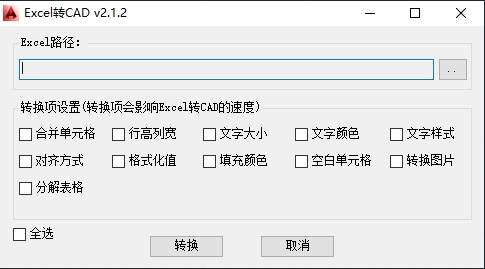
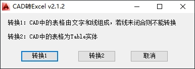

# CAD-Excel Converter 

[English](/README.md) | [中文](/README_zh.md)

## Project Introduction 

CAD-Excel Converter is a powerful AutoCAD plugin that enables bidirectional conversion between CAD tables and Excel files. The plugin uses the NPOI library for Excel file processing, supports AutoCAD software, and provides users with a convenient data conversion solution.

## Key Features 

### 🔄 Bidirectional Conversion 
- **Excel → CAD**: Convert Excel spreadsheets to CAD tables 
- **CAD → Excel**: Export CAD tables to Excel files 
- **Format Preservation**: Retains the original format and structure of data during conversion

### 📊 Format Support 
- **Excel**: .xlsx, .xls files 
- **CAD**: Native AutoCAD table objects，Line + Text composed table

### 🎨 User Interface

- **Graphical Interface**: Friendly Windows Forms UI
- **Progress Display**: Real-time progress feedback during conversion
- **Adaptive Toolbar**: Automatically creates CUI or Ribbon toolbar based on AutoCAD workspace
- **Quick Access**: Launch conversion functions quickly via toolbar buttons





## System Requirements

### Software Dependencies

- **Operating System**: Windows 7/8/10/11
- **CAD Software**: AutoCAD 2010 or later
- **.NET Framework**: 4.7.2 or later

### Main Libraries

```
NPOI >= 2.5.6                    # Excel file processing
Autodesk AutoCAD .NET API        # CAD integration
System.Windows.Forms             # User interface
```

## Installation

### Automatic Installation

1. Rebuild the Setup project
2. Locate the generated `CADTool.msi` installer
3. Double-click to run the installer
4. Follow the installation wizard to complete setup
5. Restart AutoCAD to load the plugin

### Manual Installation

1. Copy the compiled `CADConverter.dll` to the AutoCAD plugins directory
2. Use AutoCAD's `NETLOAD` command to load the plugin
3. Or add the plugin path to AutoCAD's startup configuration

## Usage

### Excel to CAD

1. In AutoCAD, click the "ExcelToCAD" toolbar button
2. In the dialog, select the Excel file to convert
3. Set conversion parameters (such as rows/columns, text size/color, etc.)
4. Click the "Convert" button to start conversion

### CAD to Excel

1. In AutoCAD, click the "CADToExcel" toolbar button
2. Select the CAD table object or text area to convert
3. Specify the save location for the Excel file
4. Click the corresponding conversion button to start

## Project Structure

```
CAD-Excel Converter/
├── CADConverter/            # Main source code
│   ├── Commands.cs          # Command definitions and toolbar creation
│   ├── ExcelToCAD.cs        # Core logic for Excel to CAD
│   ├── CADToExcel.cs        # Core logic for CAD to Excel
│   ├── Program.cs           # Plugin entry point
│   ├── FormExcelToCAD.cs    # Excel to CAD UI
│   ├── FormCADToExcel.cs    # CAD to Excel UI
│   ├── CADTool.cs           # CAD operation utilities
│   ├── CuiTool.cs           # CUI toolbar management
│   ├── RibbonTool.cs        # Ribbon toolbar management
│   ├── Log.cs               # Logging
│   ├── Model.cs             # Data models
│   └── Resources/           # Resources (icons, etc.)
├── SetupLibrary/            # Installer library
├── Setup/                   # Installer generation
├── Dlls/                    # AutoCAD API dependencies
├── imgs/                    # Example images
└── packages/                # NuGet dependencies
```

## License

MIT License
