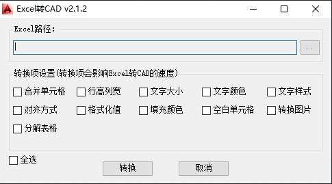
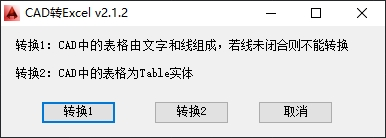

# CAD-Excel转换器 

[English](/README.md) | [中文](/README_zh.md)

## 项目介绍

CAD-Excel转换器是一个功能强大的AutoCAD插件，实现CAD表格与Excel文件之间的双向转换。该插件使用NPOI库处理Excel文件，支持AutoCAD软件，为用户提供便捷的数据转换解决方案。

## 功能特点

### 核心转换功能

- **Excel转CAD表格**：将Excel文件中的数据转换为CAD表格对象
- **CAD转Excel文件**：将CAD中的表格数据导出为Excel文件
- **格式保持**：尽可能保持原始数据的格式和样式

### 支持的文件格式

- **Excel格式**：支持.xlsx和.xls文件格式
- **CAD格式**：支持AutoCAD原生表格对象，Line + Text 组合的表格

### 用户界面功能

- **图形化界面**：提供友好的Windows Forms界面
- **进度显示**：转换过程中的实时进度反馈
- **自适应工具栏**：根据AutoCAD工作空间自动创建CUI或Ribbon工具栏
- **快捷访问**：通过工具栏按钮快速启动转换功能





## 系统要求

### 软件依赖

- **操作系统**：Windows 7/8/10/11
- **CAD软件**：AutoCAD 2010或更高版本
- **.NET Framework**：4.7.2或更高版本

### 主要依赖库

```
NPOI >= 2.5.6                    # Excel文件处理
Autodesk AutoCAD .NET API        # CAD集成接口
System.Windows.Forms             # 用户界面
```

## 安装说明

### 自动安装

1. 重新生成Setup项目
1. 找到生成的`CADTool.msi`安装包
2. 双击运行安装程序
3. 按照安装向导完成安装
4. 重启AutoCAD以加载插件

### 手动安装

1. 将编译后的`CADConverter.dll`文件复制到AutoCAD插件目录
2. 使用AutoCAD的`NETLOAD`命令加载插件
3. 或将插件路径添加到AutoCAD的启动配置中

## 使用方法

### Excel转CAD

1. 在AutoCAD中点击工具栏的"ExcelToCAD"按钮
2. 在弹出的对话框中选择要转换的Excel文件
3. 设置转换参数（如行列、文字大小/颜色等）
4. 点击"转换"按钮开始转换

### CAD转Excel

1. 在AutoCAD中点击工具栏的"CADToExcel"按钮
2. 选择要转换的CAD表格对象或文本区域
3. 指定Excel文件的保存位置
4. 按照所选实体点击对应转换按钮开始转换

## 项目结构

```
CAD-Excel转换器/
├── CADConverter/            # 主要源代码目录
│   ├── Commands.cs          # 命令定义和工具栏创建
│   ├── ExcelToCAD.cs        # Excel转CAD核心逻辑
│   ├── CADToExcel.cs        # CAD转Excel核心逻辑
│   ├── Program.cs           # 插件入口点
│   ├── FormExcelToCAD.cs    # Excel转CAD用户界面
│   ├── FormCADToExcel.cs    # CAD转Excel用户界面
│   ├── CADTool.cs           # CAD操作工具类
│   ├── CuiTool.cs           # CUI工具栏管理
│   ├── RibbonTool.cs        # Ribbon工具栏管理
│   ├── Log.cs               # 日志记录功能
│   ├── Model.cs             # 数据模型定义
│   └── Resources/           # 资源文件（图标等）
├── SetupLibrary/            # 安装程序库
├── Setup/                   # 安装包生成
├── Dlls/                    # AutoCAD API依赖库
├── imgs/                    # 示例图片
└── packages/                # NuGet包依赖
```

## 许可证

MIT License